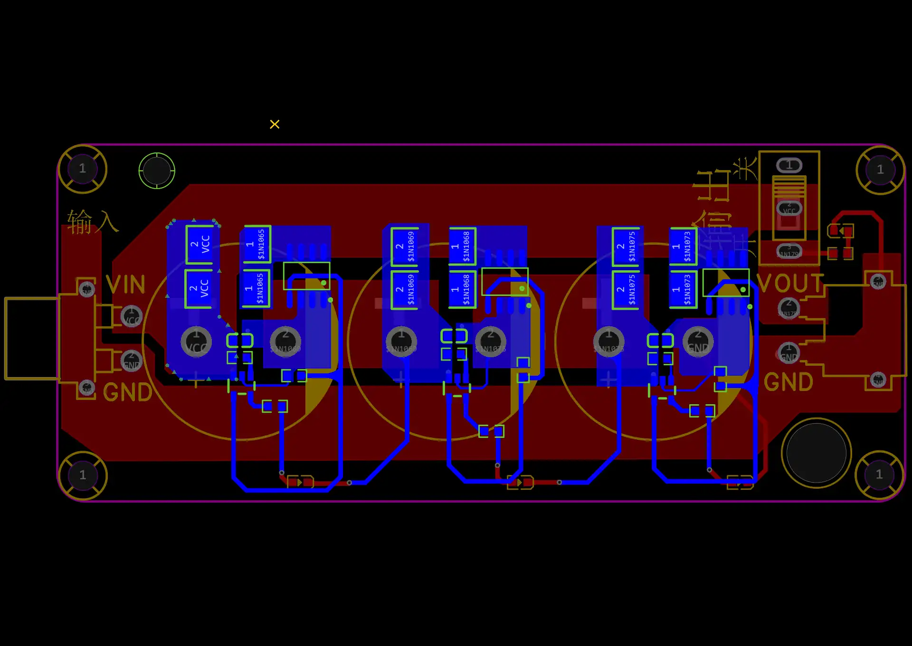
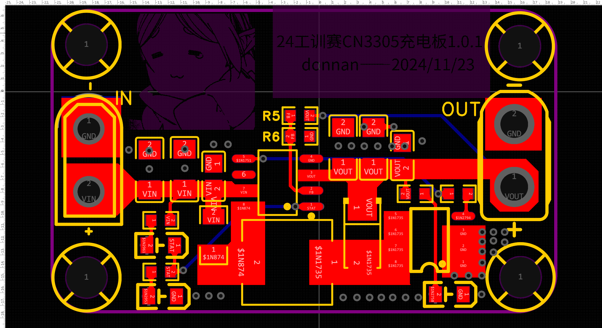
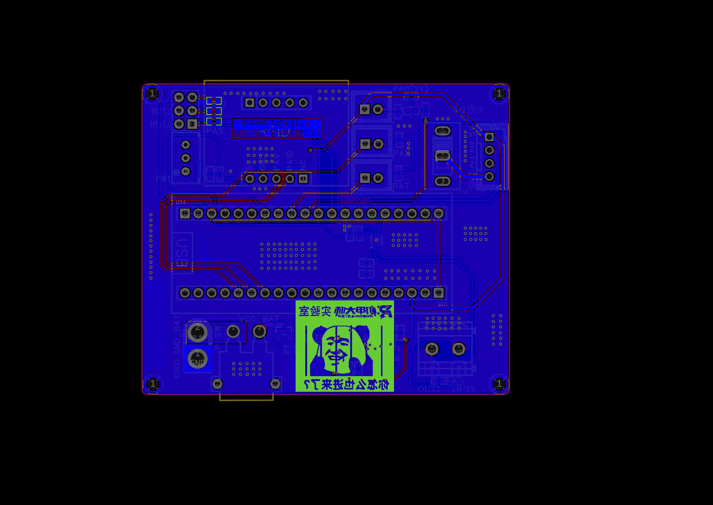

# 太阳能小车 PCB 设计方案总结

这是一个围绕工训太阳能小车应用展开的早期 PCB 设计项目。方案将充电、超级电容储能和电机控制分成三块板，尝试把能量输入、储存与使用组织成一套完整的硬件结构。本次开源主要用于整理和回顾这一阶段的设计思路，保留当时的器件选择与模块划分。

原工程名称：24年工训太阳能小车控制板  
设计工具：嘉立创 EDA 专业版  
作者：[mnblzs](https://github.com/mnblzs)

## 整体架构

整体采用“升压充电板 → 超级电容板 → 控制扩展板”的结构。充电板负责能量输入，电容板承担储能与单体保护，扩展板完成电源变换并连接主控和电机。三块板通过接插件连接，电源、开关和状态指示分布在对应功能模块上。

## PCB 预览

以下为工程自带的 PCB 布局预览。

| 超级电容板 | 充电板 | 控制扩展板 |
|---|---|---|
|  |  |  |

## 超级电容储能板

储能部分采用三只标称 100F、2.7V 的超级电容串联，理想等效电容约为 33.3F。各单体配置 BW6101，并配合 AO4402-MS、功率电阻和指示电路形成过压泄放保护支路。

这块板将电容本体与保护电路放在一起，使储能模块具有相对独立的结构。设计关注的不仅是电容组的总电压，也包括串联后各单体的电压分配，以及保护支路中的功率消耗。

## 升压充电板

充电部分采用 CN3305 升压充电控制方案，外围包括 AO4468、SS34、6.8µH 电感、电流检测电阻和反馈分压。现有分压设定对应的理论充电终止电压约为 7.35V。

将充电电路独立成板，使其与储能及负载侧分开，便于单独调整输入与充电方案。工程中的充电板统一命名为“CN3305充电板1.0.1”。

## 控制扩展板

本项目是一款面向2024年工训新能源小车设计的控制底板，适配STM32F103最小系统板，集成稳压供电、电机驱动及外设接口。

电源部分采用TPS63070RNMT升降压芯片，输出设定约为5V，以适应超级电容放电过程中的电压变化，并配置输入反接保护电路。

电机驱动部分采用DRV8837DSGR有刷直流电机驱动芯片，可配合单片机程序实现电机缓启动和调速。板上提供RFID读卡器、语音模块、顶部红色标记灯、辅助状态灯及模式选择接口，便于连接小车外围模块。

本项目为早期个人练习作品，开源内容以PCB设计及硬件功能介绍为主，欢迎交流与改进建议。

部分设计思路参考了社区公开方案，在此感谢相关作者。

## 接口说明

以下使用原理图位号及引脚编号。不同板上的同名位号分别属于各自板块，针序以工程编号为准。

### 充电板与超级电容板

| 板块 / 接口 | 引脚定义 | 用途 |
|---|---|---|
| 充电板 CN1（XT30） | 1：GND；2：VIN（+） | 外部太阳能电源输入 |
| 充电板 CN4（XT30） | 1：VOUT（+）；2：GND | 充电输出，接电容板；理论终止电压约7.35V |
| 电容板 U37（XT30） | 1：VCC（+）；2：GND | 直接接电容组两端，用于充电 |
| 电容板 CN1（XT30） | 1：GND（−）；2：经U1开关接通的正极（+） | 向控制扩展板供电 |

电容板 XT30 封装的3、4脚为辅助焊脚，工程中接GND。

### 控制扩展板

| 接口 | 引脚定义 / 连接 | 说明 |
|---|---|---|
| CN3（XT30） | 1：GND_BAT（−）；2：VCC_BAT（+） | 电容电源输入，正极经AO3401A支路进入电源变换电路 |
| CN2（XT30） | 1：板内GND；2：GND_BAT | 外接电源总开关（丝印P-SW），通过负极回路控制整板通断 |
| U6（2针接线端子） | 1：OUT1；2：OUT2 | 直流电机输出；驱动IN1接PA1、IN2接PA0 |
| CN1（XH，4针） | 1：5V；2：PA2；3：PA3；4：U1开关支路 | 语音播报模块（丝印确认），用于播报标志点信息；第4针由U1开关接地 |
| H6（5针） | 1：NC（丝印）；2：PA10；3：PA9；4：GND；5：5V | RFID读卡模块（丝印确认），用于识别赛道UID标签 |
| U8（XH，2针） | 1：PA8；2：经R5接3V3 | 辅助状态指示灯，可由PA8拉低导通 |
| U9（XH，2针） | 1：PA7；2：经R7接3V3 | 辅助状态指示灯，可由PA7拉低导通 |
| U12（XH，2针） | 1：5V；2：经R13接Q2集电极 | 顶部红色标记灯；PA6经R14驱动Q2，形成5V低侧开关支路 |
| U13（2×3排针） | 1/2：PA5/3V3；3/4：PA4/3V3；5/6：PB10/3V3 | 模式选择跳帽（丝印“模式1/2/3”）；信号各有下拉电阻，短接对应引脚对时置高 |
| H7（5针） | 1～5：GND | 公共地引出 |
| U14、U15（各20针） | GPIO、5V、3V3、GND等，完整针序见原理图 | 外接STM32F103最小系统板 |

上述接口用途已由作者确认：U12用于顶部红色标记灯，U8/U9用于辅助状态指示灯；CN1、H6、CN2及U13分别用于语音播报、RFID读卡、电源总开关及模式选择。具体读卡/语音模块型号、通信协议参数及三种模式的软件含义未在本次硬件说明中展开。

板内5V由TPS63070电源支路提供，3V3与外接主控板接口相连。电源入口GND_BAT与板内GND是不同网络，需要结合CN2支路区分。

参考：[2024年福建省新能源车赛道评分与规则](https://www.xit.edu.cn/_upload/article/files/fe/48/3b7c2c654c30a55c4a0f8a0e0edf/41769a3d-e94a-4d99-a59d-d23a3f2c0312.pdf)及[福州大学分区赛通知附件3](https://jwch.fzu.edu.cn/info/1039/13700.htm)。规则用于解释使用场景，不证明接口的实际接线。

## 设计回顾

回看这套方案，比较明确的取舍是模块独立性与整机集成度之间的平衡。分板设计使不同功能容易区分，也带来了更多接插件、跨板连线和安装空间需求；外接最小系统板减少了主控部分的重复设计，同时使接口定义和供电路径成为整机配合的重要条件。

超级电容的电压变化把电源设计放在了较重要的位置。升降压方案服务于负载供电的稳定性，而电机启动与保护支路又会影响能量消耗和发热。这些模块之间的关系，是这次早期设计中值得保留的经验。

存档版本也保留了一些需要重新核对的细节，主要是电容保护支路中功率电阻的 BOM 标值。本次整理聚焦方案总结，文中的标称参数和理论设定不作为整板实测性能结论。

完整嘉立创工程：[24年工训太阳能小车控制板.epro2](hardware/24%E5%B9%B4%E5%B7%A5%E8%AE%AD%E5%A4%AA%E9%98%B3%E8%83%BD%E5%B0%8F%E8%BD%A6%E6%8E%A7%E5%88%B6%E6%9D%BF.epro2)。

## 工程组成

| 板块 | 原理图 | PCB |
|---|---|---|
| cap | Schematic1_2 / P1 | PCB1_2 |
| CN3305充电板1.0.1 | Schematic1 / P1 | PCB1 |
| 扩展板1.1.1 | Schematic1_1 / P1 | PCB1_1 |

## 器件资料与许可

[CN3305](https://atta.szlcsc.com/upload/public/pdf/source/20220613/3F3584037E2080F5D94DBBCFA6ED222C.pdf) · [TPS63070](https://www.ti.com/lit/ds/symlink/tps63070.pdf) · [DRV8837](https://www.ti.com/lit/ds/symlink/drv8837.pdf) · [BW6101](https://bitwell.cn/productview.aspx?CateID=607&ID=269)

本项目中作者拥有权利的设计文件与说明采用 [MIT License](LICENSE) 发布。第三方器件资料、元件库、模型及标识的权利归原权利人所有；本许可不改变其原有授权。历史参考设计来源仍待补充。

